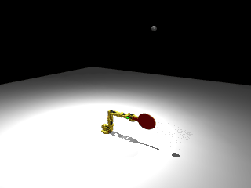

# so101-robotic-learning

<div align="center" style="max-width:900px; margin:auto;">

<br>

</div>

## Patch notes
- **bounce_rl:**
  - **Juggling objective**: bounce detection at every substep, bounce bonus, auxiliary reward shaping, and drop penalty.
  - **Episode failures**: terminate at the first physics substep with paddle-ground contact or a ball-to-paddle distance greater than 2 m. Apply the existing failure penalty once (-5 by default). Record each cause separately in reports and TensorBoard.
  - **Energy penalty**: integrate absolute actuator mechanical work at every physics substep. Configurable weight, enabled at `0.01` in PPO/SAC notebooks, with episode totals and penalties logged in TensorBoard.
  - **Ball alignment penalty**: penalize distance to the nearest point on a vertical segment from 0.2 m to 1.2 m above `paddle_face`. Integrate over simulated time and expose configuration and metrics in PPO/SAC notebooks and TensorBoard.
  - **Composite rewards**: `RewardMultiObjectif` combines named weighted rewards, penalties and nested composites. Existing rewards remain compatible. Per-component contributions are available in episode reports and TensorBoard.
  - **Gravity curriculum**: optional PPO/SAC progression from 3 to 9.81 m/s², advancing after 5 consecutive training bounces. Stages apply at reset, are shared across workers and persist beside checkpoints. Evaluation is read-only.
  - **Hyperparameter search**: optional Optuna grid, TPE and Gaussian-process searches for PPO/SAC, with a dedicated notebook, resumable SQLite studies and JSON/CSV exports. Existing training notebooks are preserved.
  - **Resume training**: PPO/SAC accept `resume_from`. Continue timestep counters in a new TensorBoard run. SAC saves and restores replay buffers beside best and last checkpoints.
  - **Unified reward API**: `reward` defines the full objective everywhere. Weights live in the composite, and geometric settings stay in `env_kwargs`. PPO/SAC notebooks and policy tests share the same configured reward.
  - **Corrected rewards**: computation without modifying the physics, local `paddle_face` frame, active face only, and a shared default reward for PPO/SAC.
  - **Metrics and checkpoints**: tracking of streaks, success, drops, and impact dispersion. Best-model selection based on juggling performance, with JSON reports.
  - **Reliable evaluation**: handling of vectorized environments, step limits, callback thresholds, and terminal frames before reset.
  - **TensorBoard**: metrics logged at every evaluation and PPO/SAC losses verified. Logs stored in `runs/ppo_bounce/` and `runs/sac_bounce/`, without `experiments`.
  - **Cameras**: external view reserved for visualization, gripper view retained for the agent, and synchronized GIFs of both views with a single slider. MP4 exports removed, including during tests.
  - **Updated notebooks**: current configurations, robust paths, dated runs, and old outputs cleared.
  - **Faster rendering**: `train_fast` profile, one frame per decision, and external camera limited to the recorded episode. Physics unchanged. Local speedup of approximately **6×**, excluding neural network training.
  - **Validation**: **96 tests pass**, covering gravity curriculum stages and resumption, grid/TPE/GP searches, study resumption and pruning, checkpoint resumption, replay buffers, composite objectives, penalties, episode termination, notebooks and TensorBoard files.
<!---

## Arborescence

```

├── README.md
├── .gitignore
│
├── assets/                     # Tout ce qui est physique
├── img/
├── notebooks/
|
└── src/
   └── bounce_rl/
       ├── envs/
       │   ├── bounce_env.py        # Gymnasium env principal
       │   ├── reset.py             # stratégies de reset
       │   ├── observations.py
       │   ├── rewards.py
       │   ├── events.py            # détection de rebond
       │   └── termination.py
       │
       ├── sim/
       │   ├── mujoco_loader.py
       │   ├── controllers.py       # PD / position control
       │   ├── domain_randomization.py
       │   └── physics_tuning.py    # restitution, friction…
       │
       ├── rl/
       │   ├── train.py
       │   ├── eval.py
       │   ├── callbacks.py
       │   └── wrappers.py
       │
       ├── real_robot/              
       │   ├── so101_interface.py
       │   ├── safety_limits.py
       │   └── calibration.py
       │
       ├── perception/
       │   ├── ball_tracking.py
       │   ├── kalman.py
       │   └── latency_compensation.py
       │
       ├── configs/
       │   ├── env.yaml
       │   ├── sac.yaml
       │   ├── randomization.yaml
       │   └── real_robot.yaml
       │
       ├── utils/
       │   ├── seeds.py
       │   ├── logger.py
       │   └── paths.py
       │
       └── __init__.py
```

-->

## Setup environnement

```
conda env create -f environment.yml
conda activate so101-robotic-learning
```

## Reprendre un entraînement PPO ou SAC

Dans le notebook, conserver le nouveau dossier daté et renseigner le checkpoint :

```python
train_config["resume_from"] = root / "models/ancien_run/sac_bounce_last.zip"
train_config["total_timesteps"] = 100_000  # pas supplémentaires
train_sac.train(**train_config)
```

Pour PPO, utiliser un checkpoint `ppo_bounce_last.zip` ou `ppo_bounce_best.zip`
et appeler `train_ppo.train`. Les chemins relatifs sont résolus depuis `root`.
L’architecture, l’optimiseur et les hyperparamètres sont restaurés depuis le modèle.
Les paramètres correspondants du nouvel appel sont ignorés lors de la reprise.
L’environnement, la reward, le device et l’évaluation utilisent la nouvelle configuration.
Les observations et actions doivent rester compatibles. La simulation redémarre au reset,
sans restaurer une trajectoire physique ou un rollout PPO partiel.

Un nouveau run TensorBoard utilise les pas cumulés. Le budget est supplémentaire,
avec un arrondi possible au rollout PPO ou à la fréquence de collecte SAC.
Les compteurs d’épisodes et le classement du meilleur modèle repartent pour cette session.
Utiliser un nouveau `model_dir_name` pour conserver les checkpoints précédents.

SAC enregistre par défaut `*_best_replay_buffer.pkl` et `*_last_replay_buffer.pkl`.
Le buffer voisin du checkpoint est chargé automatiquement. `replay_buffer_from` permet
de choisir un autre fichier. Le nombre d’environnements doit correspondre et la capacité
vient du buffer chargé. Sans buffer, les poids sont conservés et `learning_starts` fixe
le nombre de nouveaux pas de collecte avant les mises à jour.
Pour un buffer vide, utiliser une copie du `.zip` sans buffer voisin.
Les récompenses stockées ne sont pas recalculées si l’objectif change.
`save_replay_buffer=False` désactive ces sauvegardes, potentiellement volumineuses.

## Curriculum de gravité

Disponible dans PPO et SAC, sans modifier les observations, la reward ou les conditions de rebond.
Il est désactivé par défaut (`gravity_curriculum=None`). Pour l’activer dans les notebooks :

```python
from so101_robotic_learning.bounce_rl.env.gravity_curriculum import GravityCurriculumConfig

train_config["gravity_curriculum"] = GravityCurriculumConfig(
    start_gravity=3.0,
    gravity_step=1.0,
    target_gravity=9.81,
    success_bounces=5,
)
```

Les valeurs sont des intensités positives en m/s². La gravité globale de MuJoCo est
`(0, 0, -g)`, pour la balle comme pour le robot.
La progression par défaut est `3 → 4 → 5 → 6 → 7 → 8 → 9 → 9.81`.
Un environnement d’entraînement doit atteindre 5 rebonds consécutifs validés au palier courant
pour programmer le suivant. Les contacts bruts ou le total de rebonds non consécutifs ne suffisent pas.
Un épisode ne fait progresser qu’un palier, même s’il dépasse ensuite 10 ou 15 rebonds.
La gravité reste constante pendant l’épisode et change au prochain reset, sans provoquer
un reset supplémentaire à la réussite. La progression s’arrête à la gravité cible.

Les workers `DummyVecEnv` partagent la progression. Les succès d’épisodes encore en cours à un
ancien palier ne peuvent pas sauter de paliers. Chaque worker rejoint le palier courant à son reset.
Les évaluations et tests de politique utilisent le palier sauvegardé ou courant sans le faire avancer.
Les meilleurs checkpoints sont sélectionnés d’abord par palier, puis selon les métriques de jonglage.
Cela permet à un modèle évalué à une gravité plus élevée de remplacer un checkpoint de niveau facile.

Les fichiers `*_best_curriculum.json` et `*_last_curriculum.json` conservent la configuration et
le prochain palier à appliquer. Les garder avec les `.zip` pour que `resume_from` restaure le
curriculum automatiquement, même si le nouvel appel laisse `gravity_curriculum=None`.
Une configuration explicite différente est refusée. Un ancien modèle sans ce fichier peut démarrer
un nouveau curriculum en fournissant `GravityCurriculumConfig(...)`.

TensorBoard enregistre `curriculum/train_gravity_m_s2` (gravité réellement utilisée),
`curriculum/next_gravity_m_s2` (palier programmé), `curriculum/level`, `curriculum/complete`
et `eval/mean_gravity_m_s2`. Les rapports contiennent aussi le palier et la gravité des épisodes.
Le buffer SAC est conservé entre les paliers. La recherche d’hyperparamètres demande une gravité
fixe, donc `gravity_curriculum=None`, pour comparer les configurations sur une tâche identique.

## Recherche d’hyperparamètres (optionnelle)

Installer depuis la racine du dépôt :

```bash
pip install -e ".[hpo]"
```

Ouvrir [le notebook de recherche](notebooks/bounce_rl/notebook_hyperparameter_search.ipynb).
Il complète les notebooks PPO et SAC existants. Choisir `ALGORITHM`, `METHOD`, le budget
et les paramètres à explorer, puis exécuter les cellules dans l’ordre.

Le même module peut être appelé depuis du Python avec une configuration d’entraînement existante :

```python
from so101_robotic_learning.bounce_rl.rl.hyperparameter_search import optimize

study = optimize(
    algorithm="ppo",
    base_config=train_config,
    method="grid",  # "tpe", "gp" ou "bayesian" pour un processus gaussien
    search_space={
        "learning_rate": [1e-4, 3e-4],
        "batch_size": [64, 128],
    },
    study_name="ppo_grid_essai_01",
    n_trials=None,
    eval_every_timesteps=10_000,
    seed=42,
)
print(study.best_params)
```

Pour TPE/GP, les paramètres peuvent aussi utiliser une distribution continue :
`{"learning_rate": {"type": "float", "low": 1e-5, "high": 1e-3, "log": True}}`.
Les distributions entières utilisent `"type": "int"`, avec `low`, `high` et éventuellement `step`.
`n_steps` et `train_freq` utilisent des listes d’entiers positifs pour conserver un budget commun.
Sans `search_space`, chaque méthode propose un espace par défaut adapté à PPO ou SAC.

`n_trials=None` parcourt toute la grille restante, ou lance 10 nouveaux essais TPE/GP.
Un entier indique le nombre maximal d’essais supplémentaires. Les essais sont séquentiels.
Le budget de transitions est arrondi à une frontière de collecte commune aux configurations.
Les combinaisons PPO dont le batch ne divise pas le rollout sont écartées sans entraînement.
La tâche, la reward et la seed restent fixes. `resume_from` doit être `None`.
Le score maximise `mean_max_consecutive_bounces` sur la politique finale après ses mises à jour.
Il est distinct du classement habituel du checkpoint `*_best.zip`.
`pruning=True` active un arrêt anticipé après `pruning_warmup_steps` et les essais initiaux.
Le pruning est désactivé par défaut. `timeout` limite le démarrage de nouveaux essais,
sans interrompre un entraînement en cours.

Les résultats sont enregistrés dans `models/<study_name>/` :

- `study.db` pour continuer la recherche avec le même nom et les mêmes paramètres
- `search_config.json` pour la configuration, la reward et le budget effectif
- `trials.csv`, `best_params.json` et `best_trial.json` pour les résultats
- `trial_0000/`, etc., pour les modèles, configurations et rapports d’évaluation

Les logs restent sous `runs/ppo_bounce/<study_name>/` ou `runs/sac_bounce/<study_name>/`.
Les GIF et les exports de replay buffers sont désactivés pendant la recherche.
Les essais terminés sont conservés lors d’une reprise. Un essai interrompu ne reprend pas
son entraînement. Une grille déjà terminée ne relance pas ses combinaisons.
Une modification du budget, de la tâche ou de l’espace de recherche demande un nouveau nom.

Pour réentraîner avec les meilleurs réglages, fusionner `study.best_params` dans la configuration
habituelle et utiliser un nouveau dossier daté. La dernière cellule du notebook fournit cet exemple.
Vérifier les finalistes avec plusieurs seeds. Les états initiaux fixes actuels limitent la mesure
de robustesse, même en répétant les évaluations.

## Environnements

### bounce_rl

**bounce_rl** consists of a reinforcement learning gym environment designed around a bouncing-ball and paddle setup made with mujocco. The goal is to train an agent to control the paddle so as to maintain a stable and continuous bouncing behavior of the ball.

#### *Scripts*

```
cd scripts/bounce_rl
python [script_name].py
```

- **debug.py :** exemples to launch the **bounce_rl** environment.
- **train_ppo.py :** exemples to train a ppo policy on the **bounce_rl** environment.
- **train_sac.py :** exemples to train a sac policy on the **bounce_rl** environment.
- **test_ppo.py :** exemples to test and vizualise a ppo policy on the **bounce_rl** environment.
- **test_sac.py :** exemples to test and vizualise a sac policy on the **bounce_rl** environment.

#### *Rewards*


##### *Solo*


- **PaddleParallelReward** : Evaluate if the paddle is parallel with the floor.
- **BallVerticalReward** : Evaluate if the ball’s velocity vector is perpendicular to the ground.
- **BallSpeedReward** : Evaluate if the ball’s velocity vector is close to a constent.
- **BallBelowPaddlePenalty** : Evaluate if the ball is bellow the paddle.

##### *Combination*

- **PingPongReward** : A multi-objective reward that combines several criteria.

#### TODO

- [x] **Fix and implement rewards and penalities**
  - [x] Create a composite reward for `RewardMultiObjectif`.
  - [x] Implement additional rewards :
    - [x] Penalize ball distance to a vertical 1 m segment starting 20 cm above the paddle centre.
    - [x] End the episode if the paddle touches the ground or the ball moves more than 2 m from the paddle.
    - [x] Penalize absolute actuator mechanical work, including braking.
- [x] **Start training from a pretrained model**
- [x] **Run a hyperparameter optimization.** (gridsearch, bayesian optimisation)
- [x] **Curriculum learning** (gravity)
- [ ] **Add variations to environment initialization.**
  - [ ] Implement a seeding system.
  - [ ] Vary the ball’s position and velocity vector (its trajectory must head toward the paddle).
  - [ ] Vary the ball’s mass and other properties.
  - [ ] Vary the robot/paddle position.
  - [ ] Vary the lighting.
- [ ] **When it is working, remove information unrelated to the arm (e.g., ball information).**
- [ ] **Add support for `SubprocVecEnv` ?**
- [ ] **Optimize environment execution?** (Test whether removing the paddle’s collision mesh and/or the arm’s mesh has a significant impact, reducing frame rendering and explore other optimizations, such as JAX.)
- [ ] **Sim2Real.**


<!---

#### *Benchmark*

|   | PPO  |  SAC |
|---|---|---|
| **PaddleParallelReward** | 120  | 150  |
| **BallVerticalReward**  | 32  | 40  |
| **BallSpeedReward** | 32  | 40  | 120
| **BallBelowPaddle** | 32  | 40  | 120
| **PingPongReward** | 32  | 40  | 120

-->

### Episode termination

PPO and SAC end an episode when the ball falls below 0.1 m, the collision paddle
contacts the ground, or the ball centre moves strictly more than 2 m from the
`paddle_face` site (3D Euclidean distance). All checks run at every physics substep.
The default objective applies `FailurePenalty` with weight 5 to each failure, once per terminal step.
Reaching the episode step limit remains a truncation without a failure penalty.

Both notebooks expose `BounceConfig(max_ball_paddle_distance=2.0)`. Ground planes
attached to the world are detected automatically, including unnamed planes.
For another ground geometry, set `ground_geom="geom_name"` in `BounceConfig`.

`info["termination_reason"]` distinguishes `ball_fell`, `paddle_ground_contact`
and `ball_too_far`. Episode reports retain these causes. TensorBoard logs
`eval/paddle_ground_contact_rate` and `eval/ball_too_far_rate` separately from
`eval/fall_rate`. Vector environments reset automatically after termination.
Direct users of `BounceEnv` must call `reset()` after `terminated=True`.

### Mechanical energy penalty

The `EnergyPenalty` component subtracts its weight multiplied by `energy_step_j` from each decision reward.
The energy proxy integrates `sum(abs(actuator_force * actuator_velocity)) * dt`
at every executed physics substep, using end-of-substep samples. Motor and
braking work both count positively. Opposite motor powers cannot cancel out.
An early episode termination counts only the substeps actually simulated.

The default objective and both notebooks use weight 0.01 for the `energy`
component, subtracting 0.01 reward per joule of absolute mechanical work.
Adjust it on the reward object before starting a run:

```python
reward.set_weight("energy", 0.01)
```

Weight zero disables its contribution while retaining the measurements.
The same default objective is used by direct `BounceEnv`, PPO and SAC calls.

Step info contains `energy_step_j` and the signed contribution `penalty_energy`.
Episode `task_metrics` and JSON reports include cumulative `mechanical_energy_j`
and `energy_penalty`. TensorBoard records `eval/mean_mechanical_energy_j` and
`eval/mean_energy_penalty`. Totals reset at the start of every episode.

This measures mechanical work, not electrical consumption. Motor losses,
electronics and holding torque at zero velocity are not included. It does not
replace a separate action-smoothness or torque-squared penalty.

### Ball distance to the target segment

The target is a finite vertical segment, aligned with world Z (perpendicular
to the horizontal ground). It follows the current `paddle_face` position but
not the paddle orientation. Its lower endpoint is 0.2 m above that centre and
its upper endpoint is 1.2 m above it, giving a total length of 1 m.

For paddle centre `(px, py, pz)` and ball centre `(bx, by, bz)`, the nearest
point is `(px, py, clip(bz, pz + 0.2, pz + 1.2))`. The Euclidean distance to
this point is zero anywhere on the segment and positive outside it, including
above and below the endpoints.

Each physics substep adds `distance_m * dt` to a distance integral. The decision
reward subtracts the `BallSegmentPenalty` weight times `integral_m_s`, independently
of the energy and failure penalties and the existing reward shaping. The time
integration avoids multiplying the penalty when reducing `frame_skip` and
includes only executed substeps when an episode ends early.

Both notebooks keep the geometry in `env_kwargs` and the weight in the reward:

```python
env_kwargs.update(ball_segment_start_height=0.2, ball_segment_length=1.0)
reward.set_weight("ball_segment", 1.0)
```

The default weight is 1.0 reward per metre-second. Remaining 0.5 m away for one
simulated second subtracts 0.5 reward. Weight zero disables this contribution
while retaining the measurements.

Step info exposes `ball_segment_distance_m`, `segment_closest_point`, the
step's `segment_distance_integral_m_s` and its signed `penalty_ball_segment`.
Episode reports contain the cumulative integral, the time-weighted
`mean_ball_segment_distance_m` and cumulative signed `ball_segment_penalty`.
TensorBoard records `eval/mean_ball_segment_distance_m` (the mean of episode
averages) and `eval/mean_ball_segment_penalty`. Cumulative values reset with
every episode and the average distance is undefined before any simulated step.

### Composite multi-objective rewards

`reward` is the single parameter for the **complete objective** in `BounceEnv`
and in PPO/SAC `train()` and `test()`. A provided objective is used as-is, with
no extra shaping factor, bounce bonus or penalty added by the environment.
Leaving it unset, or passing `None`, creates a fresh default composite:

| Component | Weight |
|---|---:|
| `bounces` | 5.0 |
| `shaping` (alignment and paddle orientation) | 0.05 |
| `failure` | 5.0 |
| `energy` | 0.01 |
| `ball_segment` | 1.0 |

These defaults are identical for direct environments, training and policy tests.
For a quick configuration:

```python
from so101_robotic_learning.bounce_rl.rewards import make_default_reward

reward = make_default_reward()
reward.set_weight("energy", 0.02)
train_config["reward"] = reward
```

For an explicit tree, as used in both training notebooks:

```python
from so101_robotic_learning.bounce_rl.rewards import (
    RewardMultiObjectif, BounceReward, FailurePenalty,
    EnergyPenalty, BallSegmentPenalty,
)
from so101_robotic_learning.bounce_rl.rewards.reward_ball_aligned_on_z_and_above_paddle import (
    BallAlignedOnZAndAbovePaddleReward,
)

reward = (
    RewardMultiObjectif()
    .add_reward("bounces", BounceReward(), weight=5.0)
    .add_reward("shaping", BallAlignedOnZAndAbovePaddleReward(), weight=0.05)
    .add_penalty("failure", FailurePenalty(), weight=5.0)
    .add_penalty("energy", EnergyPenalty(), weight=0.01)
    .add_penalty("ball_segment", BallSegmentPenalty(), weight=1.0)
)
train_config["reward"] = reward
```

Pass that same object to policy tests, for example
`train_sac.test(..., reward=train_config["reward"], env_kwargs=env_kwargs)`.
Geometric settings, episode limits and physical parameters remain in
`env_kwargs`. Failure detection remains active regardless of the objective,
so include `FailurePenalty` when those events should reduce the reward.

`RewardMultiObjectif` implements the Composite pattern through the common
`RewardComponent` interface. Children can be leaves or other composites.
Existing `compute(model, data)` classes are automatically adapted. A standalone
leaf also defines the complete objective and is used at weight 1.0.

```text
total = sum(weight * reward_value) - sum(weight * abs(penalty_value))
```

`add_penalty` accepts positive costs and existing negative penalty scores
without turning them into bonuses. There is no implicit normalization. Weights
must be finite and nonnegative, names unique and nonempty, and cycles are
rejected. Weight zero still evaluates diagnostics. Use `set_weight(name, weight)`
and `remove(name)` to edit the tree before training, or edit `env.reward` for an
existing environment. Every provided objective is copied per environment.
Stateful leaves can inherit `RewardComponent` and implement `reset(model, data)`.

The immutable `RewardContext` supplies `bounce_count`, `failed`, `energy_j` and
`segment_distance_integral_m_s`, including all executed physics substeps.
`info["reward_components"]` exposes each child's raw value, weight, kind, signed
contribution and details. Nested composites retain their own tree in `details`.
Legacy flat diagnostic channels follow canonical top-level component names.
Episode reports include cumulative contributions, and TensorBoard logs their
mean episode sums under `eval/reward_components/<name>`.

Migration: the old `reward_composite` option and separate reward weights in
`env_kwargs` have been removed. Move all weights into the tree and pass it as
`reward`. Existing two-argument reward classes still work, but their value is
now the whole score. To keep an old auxiliary shaping function, explicitly add
it to a composite with the desired weight alongside the other components.
