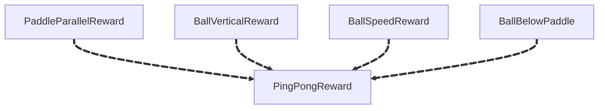

# so101-robotic-learning

<div align="center" style="max-width:900px; margin:auto;">

<br>

</div>

## Patch notes
- **bounce_rl  :** 
  - **Objectif de jonglage** : détection des rebonds à chaque sous-pas, bonus de rebond, shaping auxiliaire et pénalité de chute.
  - **Récompenses corrigées** : calcul sans modifier la physique, repère local `paddle_face`, face utile uniquement et récompense par défaut commune à PPO/SAC.
  - **Métriques et checkpoints** : suivi des séries, réussite, chutes et dispersion des impacts. sélection du meilleur modèle selon les performances de jonglage et rapports JSON.
  - **Évaluation fiabilisée** : gestion des environnements vectorisés, limites de pas, seuils du callback et images terminales avant reset.
  - **TensorBoard** : métriques enregistrées à chaque évaluation et pertes PPO/SAC vérifiées. logs dans `runs/ppo_bounce/` et `runs/sac_bounce/`, sans `experiments`.
  - **Caméras** : vue externe réservée à la visualisation, vue de pince conservée pour l'agent et GIF des deux vues synchronisées avec un seul slider. Exports MP4 supprimés, y compris pendant les tests.
  - **Notebooks adaptés** : configurations à jour, chemins robustes, essais datés et anciennes sorties nettoyées.
  - **Rendu accéléré** : profil `train_fast`, une image par décision et caméra externe limitée à l'épisode enregistré. Physique inchangée. gain local d'environ **×6**, hors apprentissage du réseau.
  - **Validation** : **41 tests passent**, incluant les notebooks et les fichiers TensorBoard.

<!---

## Arborescence

```

├── README.md
├── .gitignore
│
├── assets/                     # Tout ce qui est physique
├── img/
├── notebooks/
|
└── src/
   └── bounce_rl/
       ├── envs/
       │   ├── bounce_env.py        # Gymnasium env principal
       │   ├── reset.py             # stratégies de reset
       │   ├── observations.py
       │   ├── rewards.py
       │   ├── events.py            # détection de rebond
       │   └── termination.py
       │
       ├── sim/
       │   ├── mujoco_loader.py
       │   ├── controllers.py       # PD / position control
       │   ├── domain_randomization.py
       │   └── physics_tuning.py    # restitution, friction…
       │
       ├── rl/
       │   ├── train.py
       │   ├── eval.py
       │   ├── callbacks.py
       │   └── wrappers.py
       │
       ├── real_robot/              
       │   ├── so101_interface.py
       │   ├── safety_limits.py
       │   └── calibration.py
       │
       ├── perception/
       │   ├── ball_tracking.py
       │   ├── kalman.py
       │   └── latency_compensation.py
       │
       ├── configs/
       │   ├── env.yaml
       │   ├── sac.yaml
       │   ├── randomization.yaml
       │   └── real_robot.yaml
       │
       ├── utils/
       │   ├── seeds.py
       │   ├── logger.py
       │   └── paths.py
       │
       └── __init__.py
```

-->

## Setup environnement

```
conda env create -f environment.yml
conda activate so101-robotic-learning
```

## Environnements

### bounce_rl

**bounce_rl** consists of a reinforcement learning gym environment designed around a bouncing-ball and paddle setup made with mujocco. The goal is to train an agent to control the paddle so as to maintain a stable and continuous bouncing behavior of the ball.

#### *Scripts*

```
cd scripts/bounce_rl
python [script_name].py
```

- **debug.py :** exemples to launch the **bounce_rl** environment.
- **train_ppo.py :** exemples to train a ppo policy on the **bounce_rl** environment.
- **train_sac.py :** exemples to train a sac policy on the **bounce_rl** environment.
- **test_ppo.py :** exemples to test and vizualise a ppo policy on the **bounce_rl** environment.
- **test_sac.py :** exemples to test and vizualise a sac policy on the **bounce_rl** environment.

#### *Rewards*



##### *Solo*


- **PaddleParallelReward** : Evaluate if the paddle is parallel with the floor.
- **BallVerticalReward** : Evaluate if the ball’s velocity vector is perpendicular to the ground.
- **BallSpeedReward** : Evaluate if the ball’s velocity vector is close to a constent.
- **BallBelowPaddlePenalty** : Evaluate if the ball is bellow the paddle.

##### *Combination*

- **PingPongReward** : A multi-objective reward that combines several criteria.

#### TODO

- [ ] **Make the number of latent states dynamic** (accept a list of length `nb_states_latents` as a parameter, where `list[0]` is the step to use).
- [ ] **Add dates to model and video filenames.**
- [ ] **Add support for `SubprocVecEnv`.**
- [ ] **Fix and implement rewards.**
  - [ ] Create a composite reward for `RewardMultiObjectif`.
  - [ ] Implement additional rewards.
- [ ] **Add variations to environment initialization.**
  - [ ] Implement a seeding system.
  - [ ] Vary the ball’s position and velocity vector (its trajectory must head toward the paddle).
  - [ ] Vary the ball’s mass and other properties.
  - [ ] Vary the robot/paddle position.
  - [ ] Vary the lighting.
- [ ] **Run a hyperparameter grid search.**
- [ ] **When it is working, remove information unrelated to the arm (e.g., ball information).**
- [ ] **Optimize environment execution?** (Test whether removing the paddle’s collision mesh and/or the arm’s mesh has a significant impact, reducing frame rendering and explore other optimizations, such as JAX.)


<!---

#### *Benchmark*

|   | PPO  |  SAC |
|---|---|---|
| **PaddleParallelReward** | 120  | 150  |
| **BallVerticalReward**  | 32  | 40  |
| **BallSpeedReward** | 32  | 40  | 120
| **BallBelowPaddle** | 32  | 40  | 120
| **PingPongReward** | 32  | 40  | 120

-->
