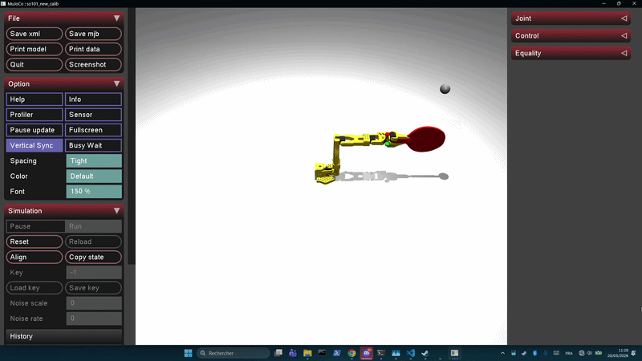
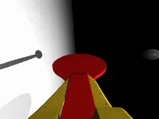
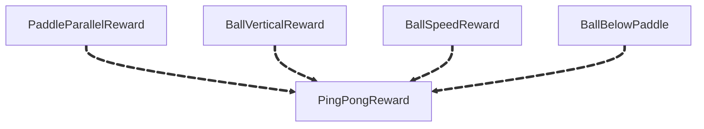

# so101-robotic-learning

## Patch notes — 18 octobre 2026

- **Objectif de jonglage** : détection des rebonds à chaque sous-pas, bonus de rebond, shaping auxiliaire et pénalité de chute.
- **Récompenses corrigées** : calcul sans modifier la physique, repère local `paddle_face`, face utile uniquement et récompense par défaut commune à PPO/SAC.
- **Métriques et checkpoints** : suivi des séries, réussite, chutes et dispersion des impacts. sélection du meilleur modèle selon les performances de jonglage et rapports JSON.
- **Évaluation fiabilisée** : gestion des environnements vectorisés, limites de pas, seuils du callback et images terminales avant reset.
- **TensorBoard** : métriques enregistrées à chaque évaluation et pertes PPO/SAC vérifiées. logs dans `runs/ppo_bounce/` et `runs/sac_bounce/`, sans `experiments`.
- **Caméras** : vue externe réservée à la visualisation, vue de pince conservée pour l'agent et GIF des deux vues synchronisées avec un seul slider. Exports MP4 supprimés, y compris pendant les tests.
- **Notebooks adaptés** : configurations à jour, chemins robustes, essais datés et anciennes sorties nettoyées.
- **Rendu accéléré** : profil `train_fast`, une image par décision et caméra externe limitée à l'épisode enregistré. Physique inchangée. gain local d'environ **×6**, hors apprentissage du réseau.
- **Validation** : **41 tests passent**, incluant les notebooks et les fichiers TensorBoard.

Redémarrer le kernel avant un nouveau lancement. Pour les anciens checkpoints, utiliser `render_profile="standard"`. Les runs existants restent en place.

<div align="center" style="max-width:900px; margin:auto;">


<p>Env mujoco</p>

<table align="center" width="100%">
  <tr>
  <td align="center" width="50%">
    <br>
    PPO raquette droite
  </td>

  <td align="center" width="50%">
    <br>
    PPO ball on paddle + upper the paddle
    </td>
</tr>
</table>

</div>

<!---

## TODO

- [x] Enregistrer checkpoints model (best_reward)
- [x] Faire en sorte que les entrainement puisse être lancés depuis un notebook (passer en paramètre fichier de config)
- [x] Ajouter etat précédent dans observations env;
- [x] Régler problèmes import en fonction de l'endroit execution fichier;
- [x] Régler problème enregistrement vidéos;
- [ ] Rendre nombres d'états latents dynamiques (prends en paramètre une liste de taille (nb_states_latents), où liste[0] = step à prendre)
- [ ] Ajouter date à noms models et vidéos;
- [ ] Cleaner fichiers train (evolutif, multi env, etc)
  - [x] Mettre tout les paramètres dans trains et tests;
  - [x] Implémenter pour DummyVecEnv;
  - [ ] Implémenter pour SubprocVecEnv;
- [ ] Corriger et faire rewards
  - [ ] Créer une composite à RewardMultiObjectif;
  - [ ] Faire autres rewards ...
    - [x] Reward position balle comprise dans un espace donné;
    - [x] Reward position raquette comprise dans un espace donné;
  - [x] Corriger raquette droite pour que ça ne concerne qu'une face de la raquette;
- [x] Détecter les rebonds valides à chaque sous-pas, sans compter plusieurs fois les contacts prolongés;
- [x] Ajouter bonus de rebond, shaping auxiliaire et pénalité de chute;
- [x] Mesurer séries de rebonds, temps avant chute et dispersion des impacts;
- [x] Sélectionner les checkpoints selon les métriques de jonglage et enregistrer les rapports;
- [ ] Tester entrainement avec muli env; 
- [ ] Ajouter variations initialisation env;
  - [ ] implémenter système seed;
  - [ ] Position balle + vecteur vitesse (la traj de la balle doit aller vers la raquette);
  - [ ] masse balle, proprité de la balle
  - [ ] Position robot / raquette;
  - [ ] lumières
- [ ] Gridsearch Hyperparamètres;
- [ ] Supprimer les informations non relatives au bras (balle par ex)
- [ ] Optimiser execution env ? (tester enlever mesh collision raquette et/ou mesh bras pour voir si grand impact + voir si autres optimisations ex : jax)

## Arborescence

```

├── README.md
├── .gitignore
│
├── assets/                     # Tout ce qui est physique
├── img/
├── notebooks/
|
└── src/
   └── bounce_rl/
       ├── envs/
       │   ├── bounce_env.py        # Gymnasium env principal
       │   ├── reset.py             # stratégies de reset
       │   ├── observations.py
       │   ├── rewards.py
       │   ├── events.py            # détection de rebond
       │   └── termination.py
       │
       ├── sim/
       │   ├── mujoco_loader.py
       │   ├── controllers.py       # PD / position control
       │   ├── domain_randomization.py
       │   └── physics_tuning.py    # restitution, friction…
       │
       ├── rl/
       │   ├── train.py
       │   ├── eval.py
       │   ├── callbacks.py
       │   └── wrappers.py
       │
       ├── real_robot/              
       │   ├── so101_interface.py
       │   ├── safety_limits.py
       │   └── calibration.py
       │
       ├── perception/
       │   ├── ball_tracking.py
       │   ├── kalman.py
       │   └── latency_compensation.py
       │
       ├── configs/
       │   ├── env.yaml
       │   ├── sac.yaml
       │   ├── randomization.yaml
       │   └── real_robot.yaml
       │
       ├── utils/
       │   ├── seeds.py
       │   ├── logger.py
       │   └── paths.py
       │
       └── __init__.py
```

-->

## Setup environnement

```
conda env create -f environment.yml
conda activate so101-robotic-learning
```

## Environnements

### bounce_rl

**bounce_rl** consists of a reinforcement learning gym environment designed around a bouncing-ball and paddle setup made with mujocco. The goal is to train an agent to control the paddle so as to maintain a stable and continuous bouncing behavior of the ball.

#### *Scripts*

```
cd scripts/bounce_rl
python [script_name].py
```

- **debug.py :** exemples to launch the **bounce_rl** environment.
- **train_ppo.py :** exemples to train a ppo policy on the **bounce_rl** environment.
- **train_sac.py :** exemples to train a sac policy on the **bounce_rl** environment.
- **test_ppo.py :** exemples to test and vizualise a ppo policy on the **bounce_rl** environment.
- **test_sac.py :** exemples to test and vizualise a sac policy on the **bounce_rl** environment.

#### *Rewards*



##### *Solo*


- **PaddleParallelReward** : Evaluate if the paddle is parallel with the floor.
- **BallVerticalReward** : Evaluate if the ball’s velocity vector is perpendicular to the ground.
- **BallSpeedReward** : Evaluate if the ball’s velocity vector is close to a constent.
- **BallBelowPaddlePenalty** : Evaluate if the ball is bellow the paddle.

##### *Combination*

- **PingPongReward** : A multi-objective reward that combines several criteria.

<!---

#### *Benchmark*

|   | PPO  |  SAC |
|---|---|---|
| **PaddleParallelReward** | 120  | 150  |
| **BallVerticalReward**  | 32  | 40  |
| **BallSpeedReward** | 32  | 40  | 120
| **BallBelowPaddle** | 32  | 40  | 120
| **PingPongReward** | 32  | 40  | 120

-->


## Vérification des corrections RL

Depuis la racine du dépôt, dans l'environnement Conda du projet :

```sh
python -m unittest discover -s tests -v
```

Ces tests nécessitent MuJoCo et un rendu offscreen fonctionnel. Ils vérifient
les récompenses sans effet de bord, le choix de récompense SAC, les évaluations
vectorisées, les seuils du callback et la capture/encodage vidéo.

PPO et SAC utilisent maintenant la même récompense par défaut
(`BallAlignedOnZAndAbovePaddleReward`). Pour reproduire les anciens essais SAC
avec `RewardInterval`, passer explicitement cette récompense à `train()` ou `test()`.

L'évaluation répartit exactement `n_eval_episodes` entre les environnements par
lots, avec au plus un épisode mesuré par environnement et par lot. `max_steps`
limite chaque épisode mesuré ; les épisodes supplémentaires lancés par le reset
automatique des environnements plus rapides ne sont pas comptabilisés.

`record_video=True` dans `BounceEnv` permet de capturer les images caméra même
avec `render_mode="human"`. Les fonctions de test et l'évaluation l'activent
lorsque la vidéo est demandée. Les images sont encodées au FPS caméra ; le
paramètre `fps` des fonctions de test permet de modifier la vitesse de lecture.


## Objectif de jonglage et métriques physiques

L'objectif par défaut est maintenant de produire des rebonds successifs sur la
face choisie de la raquette. Les anciennes récompenses géométriques servent de
shaping auxiliaire. La récompense totale d'un pas vaut :

```text
5 × nombre de rebonds validés pendant le pas
+ 0.05 × récompense géométrique
− 5 si la balle tombe
```

Ces poids sont configurables dans `BounceEnv` avec `bounce_reward_weight`,
`shaping_reward_weight` et `fall_penalty`. Une récompense passée en paramètre
`reward` est le shaping : pour reproduire son ancien score brut, utiliser les
poids `0`, `1` et `0` respectivement. Les scores des anciens entraînements ne sont
pas directement comparables aux nouveaux.

Le détecteur observe chaque sous-pas physique, même quand `frame_skip` est élevé.
Un rebond valide nécessite une vitesse d'approche relative ≤ −0.05 m/s, un
contact balle–raquette sur la face choisie, puis au moins 0.02 s sans contact,
une vitesse de départ relative ≥ 0.05 m/s et une balle qui remonte dans le monde.
La vitesse de la raquette inclut sa translation et sa rotation au point considéré.
Les contacts prolongés et les interruptions de contact plus courtes que ce délai
ne donnent pas de bonus répétés. Les contacts de bord, de dos et avec d'autres
objets ne constituent pas des rebonds valides ; un contact invalide ou une chute
interrompt la série. Le détecteur exige une face suffisamment orientée vers le
haut et un contact suffisamment aligné avec sa normale.

La scène active `assets/mjcf/so101_new_calib copy.xml` définit le site
`paddle_face`. Son axe Z pointe suivant −Y du corps `paddle_mount`. Il est placé
sur cette face au centre approximatif de la tête du mesh, dans le repère local
(`0, −0.0041, 0.174` m). Le même repère sert à l'orientation, à l'alignement de
la balle et aux coordonnées d'impact ; le décalage fixe dans le X du monde a été
supprimé. Une scène personnalisée doit fournir les geoms et le site correspondants.

`info["bounce_events"]` contient les rebonds confirmés pendant le pas.
`info["task_metrics"]` contient notamment :

- `valid_bounces`, `consecutive_bounces`, `max_consecutive_bounces` ;
- `success` : au moins 5 rebonds consécutifs par défaut ;
- `elapsed_sim_time_s` et `time_to_fall_s` : temps simulé, pas temps de calcul ;
- `contact_dispersion_m` : distance RMS des impacts à leur moyenne dans le plan
  local de la raquette, définie à partir de deux impacts valides.

La chute est détectée au sous-pas où le centre de la balle passe sous 0.1 m.
Le temps avant chute reste `null` si l'épisode s'arrête sans chute. Une limite
d'environnement ou d'évaluation sans chute est signalée comme censurée.
Une dispersion faible ne suffit pas à prouver la réussite : elle doit être lue
avec le nombre de rebonds et la durée.

L'évaluation agrège ces métriques et le callback les écrit dans TensorBoard
(`eval/success_rate`, `eval/mean_max_consecutive_bounces`, etc.) et dans un rapport
JSON à côté des modèles. Les fonctions `test()` écrivent un JSON par épisode dans
leur dossier de sortie, même si les animations sont désactivées.

Le meilleur modèle est choisi, dans cet ordre, par le taux de réussite, la
longueur moyenne des meilleures séries, le nombre moyen de rebonds et la durée
moyenne. Le score géométrique ne départage pas ces mesures. La sélection par
récompense demeure le fallback pour les environnements sans métriques de tâche.

Exemple de configuration, utilisable aussi avec SAC et avec `test()` :

```python
from so101_robotic_learning.bounce_rl.env.bounce_events import BounceConfig
from so101_robotic_learning.bounce_rl.rl import train_ppo

train_ppo.train(
    xml_path=xml_path,
    root=root,
    env_kwargs={
        "bounce_config": BounceConfig(success_bounces=10, min_flight_time=0.03),
        "bounce_reward_weight": 5.0,
        "shaping_reward_weight": 0.05,
        "fall_penalty": 5.0,
    },
)
```

Les tests incluent une scène physique simple avec plusieurs rebonds suivis d'un
repos, une collision sur le dos de la raquette, les contacts prolongés, les
vitesses relatives, les chutes, les épisodes censurés et la sélection des modèles.
Ils vérifient le mécanisme ; ils ne démontrent pas qu'une politique entraînée
sur le SO101 sait déjà jongler.


### Vérifier TensorBoard

Depuis la racine du dépôt, avec l'environnement Conda du projet activé :

```sh
tensorboard --logdir runs
```

Avec `tensorboard_log=True`, chaque évaluation est écrite et flushée immédiatement
au pas d'entraînement courant, indépendamment de l'intervalle de logs PPO/SAC.
Les scalaires sont `eval/success_rate`, `eval/mean_valid_bounces`,
`eval/mean_max_consecutive_bounces`, `eval/mean_duration_s`, `eval/fall_rate`,
`eval/mean_reward` et `eval/std_reward`. `eval/mean_time_to_fall_s` n'est enregistré
que si une chute a été observée, et `eval/mean_contact_dispersion_m` seulement si
la dispersion est définie (au moins deux impacts valides dans un épisode).
Les valeurs absentes ne sont pas remplacées par zéro. Les courbes apparaissent
à partir de la première évaluation, déclenchée par `eval_every_episodes`.

`tests/test_tensorboard_logging.py` lance de courts entraînements PPO et SAC sur
la scène MuJoCo, relit les fichiers `events.out.tfevents.*` et compare leurs valeurs
aux rapports JSON. Il vérifie aussi que plusieurs évaluations dans un même
rollout ne s'écrasent pas et que les métriques optionnelles ne sont pas réutilisées
lorsqu'elles deviennent indéfinies.


### Notebooks

Les trois notebooks de `notebooks/bounce_rl/` sont adaptés à l'objectif de rebonds.
Dans l'environnement Conda du projet, enregistrer le bon kernel si nécessaire :

```sh
python -m ipykernel install --user --name so101-robotic-learning --display-name "Python (so101-robotic-learning)"
```

Sélectionner ce kernel puis exécuter les cellules dans l'ordre. Les chemins sont
résolus depuis la racine du dépôt ou un de ses sous-dossiers. EGL n'est pas imposé
sur Windows. Après un changement des sources, redémarrer le kernel.

Les notebooks PPO/SAC exposent `env_kwargs`, les poids de récompense et le seuil
de réussite. Les logs PPO sont écrits dans `runs/ppo_bounce/PPO_N/` et les logs SAC dans
`runs/sac_bounce/SAC_N/`, sans dossier `experiments`. Les modèles et rapports
utilisent `models/<nom_daté_de_l_essai>/`. Les animations GIF sont intégrées aux
événements TensorBoard du run. Les cellules suivantes affichent les métriques et la commande
TensorBoard. `RUN_POLICY_TEST` et `RUN_TENSORBOARD` activent les étapes facultatives.

Le notebook de simulation affiche les vidéos dans le notebook, sans fenêtre
OpenCV. Son viewer natif est facultatif (`RUN_HUMAN`). Les actions aléatoires
servent à vérifier l'environnement, sans démontrer la réussite d'une politique.

Les sorties historiques ont été retirées pour éviter de confondre anciens scores
et nouvelles métriques. Les tests `test_notebooks.py` exécutent les cellules dans
de vrais kernels Jupyter, avec budgets réduits et sorties dans des dossiers
temporaires ; ils ne lancent ni viewer natif ni serveur TensorBoard.


### Pertes d'entraînement dans TensorBoard

Les noms des pertes dépendent de l'algorithme sélectionné :

| Algorithme | Perte de politique / acteur | Perte de valeur / critique |
|---|---|---|
| PPO | `train/policy_gradient_loss` | `train/value_loss` |
| SAC | `train/actor_loss` | `train/critic_loss` |

PPO enregistre aussi `train/entropy_loss`, et SAC `train/ent_coef` ainsi que
`train/ent_coef_loss` lorsque le coefficient d'entropie est appris. Les valeurs
PPO et SAC ont des définitions différentes ; leurs courbes ne sont pas renommées
pour les rendre artificiellement équivalentes.

SAC ne produit ses pertes qu'après `learning_starts` (1 000 transitions dans le
notebook par défaut) et si des mises à jour sont activées (`gradient_steps > 0`,
ou `-1` pour suivre les transitions collectées). PPO doit d'abord collecter un
rollout complet puis mettre à jour les réseaux. L'apparition des pertes dépend
aussi du prochain enregistrement des logs ; les courbes d'évaluation peuvent
donc apparaître avant les pertes d'entraînement.

Les tests TensorBoard vérifient également, avec de vraies mises à jour des
réseaux, que les pertes propres à chaque algorithme coexistent avec `eval/*`.


### Vidéos dans TensorBoard

Avec `save_eval_video=True` (valeur par défaut), le callback enregistre la vidéo
du premier épisode de chaque évaluation dans TensorBoard, sous **Images →
`eval/video`**, à son pas d'entraînement. C'est une animation GIF intégrée aux
fichiers d'événements. Aucun fichier MP4 ni dossier d'export vidéo n'est créé.
`save_eval_video=False` désactive les animations d'évaluation.
La capture fonctionne aussi avec `eval_render_mode=None`.

Depuis la racine du dépôt :

```sh
tensorboard --logdir runs
```

Sélectionner le run PPO ou SAC puis l'onglet Images. Le curseur permet de choisir
l'évaluation. Pour voir un seul algorithme, utiliser `--logdir runs/ppo_bounce`
ou `--logdir runs/sac_bounce`. Les notebooks utilisent directement ce dossier.
Les logs des entraînements déjà en cours conservent leur ancien emplacement.


### Caméra externe pour la visualisation

La scène active propose `overview_cam`, une caméra fixe qui cadre le robot,
la raquette et la balle. `gripper_cam` reste la caméra des observations de la
politique. Les notebooks configurent maintenant :

```python
env_kwargs = {
    "camera_name": "gripper_cam",       # image de l'agent, 84 × 84 par défaut
    "video_camera_name": "overview_cam", # render() et animations TensorBoard
    "video_width": 320,
    "video_height": 240,
}
```

Ces clés peuvent être ajoutées aux autres paramètres de `env_kwargs` pour
`train()` et `test()`, ou passées directement à `BounceEnv`. Les observations,
leur historique et les actions ne changent pas : aucune image de la caméra
externe n'est transmise à la politique. Le renderer externe est créé uniquement
lorsque l'environnement doit afficher une image ou enregistrer une vidéo.
Les environnements d'entraînement avec `render_mode=None` et `record_video=False`
ne calculent pas cette seconde vue. Les évaluations la capturent avec
`save_eval_video=True`, puis l'enregistrent dans **Images → eval/video**.

Sans `video_camera_name`, le rendu et les vidéos réutilisent la caméra des
observations, comme auparavant. Sans dimensions vidéo explicites, ils réutilisent
`width` et `height`. Redémarrer le kernel pour charger le nouveau code avant un
nouvel entraînement ; les checkpoints gardent le même espace d'observation.


### Deux vues dans TensorBoard

Avec `save_eval_video=True`, chaque évaluation enregistre désormais deux
animations synchronisées dans l'onglet **Images** :

- `eval/video` : la vue de visualisation (`overview_cam` dans les notebooks) ;
- `eval/gripper_cam` : la caméra des observations (`gripper_cam` par défaut).

La seconde animation réutilise les images caméra déjà calculées pour la politique,
à leur résolution d'origine, sans concaténer l'historique d'observations. Elle ne
nécessite aucun rendu supplémentaire et ne modifie pas les entrées du modèle.
Les deux vidéos incluent les images du pas terminal avant le reset automatique.
Les anciens fichiers MP4 restent sur disque ; les prochains lancements n'en produisent plus.
Redémarrer le kernel avant le prochain lancement pour charger ce changement.


### Un seul slider pour les deux caméras

Dans **Images → `eval/cameras`**, les deux vues sont affichées côte à côte dans
une même animation : caméra externe à gauche, caméra de pince à droite. Le
slider TensorBoard sélectionne donc une seule évaluation pour les deux vues,
et chaque image de l'animation réunit les deux caméras au même instant simulé.
La vue de pince est redimensionnée pour l'affichage en conservant ses proportions ;
les observations de la politique gardent leur résolution d'origine.
Les vues individuelles `eval/video` et `eval/gripper_cam` restent disponibles.
Cette vue combinée est produite aux prochaines évaluations avec
`save_eval_video=True`, après redémarrage du kernel.

Les fonctions `test()` de PPO et SAC utilisent également uniquement TensorBoard
avec `save_test_video=True` : `test/video`, `test/gripper_cam` et `test/cameras`.
Chaque pas du slider correspond au numéro d'épisode testé. Leurs événements et
rapports JSON sont écrits par défaut dans `runs/ppo_bounce/test/` ou
`runs/sac_bounce/test/`. Le paramètre historique `video_dir_name` de `test()`
permet de choisir ce dossier ; dans le notebook SAC, il inclut le nom daté de
l'essai. Pour `train()` et le callback, les anciens paramètres de dossier vidéo
sont acceptés pour compatibilité mais n'entraînent aucune création de dossier.
L'encodage GIF se fait en mémoire avec Pillow, sans FFmpeg.

### Rendu rapide pour l'apprentissage

Les fabriques PPO et SAC utilisent par défaut `render_profile="train_fast"`,
en entraînement, en évaluation et dans leurs fonctions de test. Les notebooks
explicitent ce choix dans `env_kwargs` :

```python
"render_profile": "train_fast",
"video_render_profile": "standard",
```

Le profil rapide désactive ombres, reflets et anticrénelage multisample pour
la caméra des observations. Il calcule une image au reset puis à la fin de
chaque décision, au lieu de rendre pendant les sous-pas physiques. Les images
passées restent indexées par décision. La physique, les collisions, les rewards
et la détection des rebonds conservent tous leurs sous-pas.

Les vidéos réutilisent ces images pour la vue de pince. Leur fréquence est
limitée à celle des décisions : avec `frame_skip=20` et un pas de 0,002 s,
les vidéos sont à 25 images/s. La caméra externe garde le profil `standard`
et n'est calculée que pour le premier épisode du premier environnement de
chaque évaluation enregistrée, y compris lors des resets automatiques.
Les autres épisodes continuent de fournir leurs métriques.

Pour retrouver les pixels et la cadence des anciennes observations, notamment
avec un checkpoint entraîné auparavant, passer `"render_profile": "standard"`
dans `env_kwargs`. Une instance directe de `BounceEnv` conserve ce profil
standard par défaut. Les deux profils ont les mêmes espaces d'observation,
mais des pixels différents ; conserver le même profil à l'entraînement et au test.
Redémarrer le kernel avant un nouveau lancement. Les runs existants ne sont
ni déplacés ni modifiés, et les entraînements en cours ne changent pas de profil.
